  

  
  
  
  
  
  

  I build LLM agents and the deterministic code around them: gates, tests, evals and kill switches. 
  Studying CS (AI &amp; ML) at ICFAI University, Hyderabad. Open to internships in ML systems and AI safety.

  <a href="https://haresh.acadnet.net/portfolio/">Portfolio</a> &nbsp;|&nbsp;
  <a href="https://www.linkedin.com/in/sai-haresh-anand-s-1943b223b/">LinkedIn</a> &nbsp;|&nbsp;
  <a href="https://github.com/SAI-HARISH2007?tab=repositories">All repositories</a>

## The loop I keep building

## Projects

<table width="100%">
  <tr>
    <td width="50%"></td>
    <td width="50%"></td>
  </tr>
  <tr>
    <td width="50%"></td>
    <td width="50%"></td>
  </tr>
  <tr>
    <td width="50%"></td>
    <td width="50%"></td>
  </tr>
</table>

## Activity

## How I work

I test the code around the model, not only the model, and I write down what broke.

greenlight's first verification gate was 11 lines and looked obviously right. It rejected valid evidence, and the agent responded by trying something else, including rolling back an unrelated deploy in my simulator. I rebuilt it as gate v2 and kept the regression in the README.

## Open source

- OWASP Nettacker: [PR #1730](https://github.com/OWASP/Nettacker/pull/1730) fixes a test-isolation bug and is open for review. The project lead assigned me [issue #1721](https://github.com/OWASP/Nettacker/issues/1721).
- OWASP OpenCRE: [issue #1112](https://github.com/OWASP/OpenCRE/issues/1112), a low-severity information disclosure I reported at the maintainer's request.
